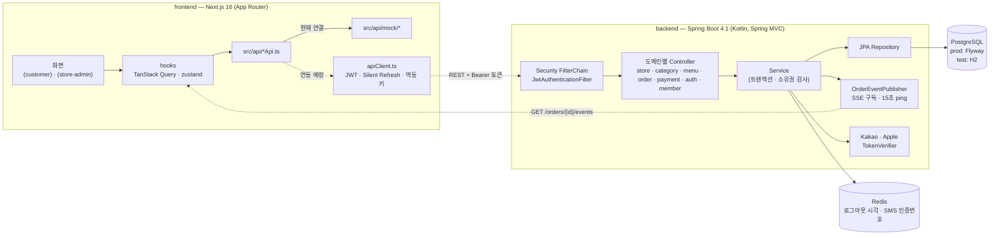

# Smart Order — 카페 실시간 선주문 & 픽업 플랫폼

> 출근길 손님이 가까운 카페에 미리 주문하고, 조리 상태를 실시간으로 받아 기다리지 않고 픽업하는 서비스입니다. Kotlin · Spring Boot 백엔드와 Next.js 화면을 혼자 만들었습니다.

- 배포(손님 화면): https://smart-order-eta.vercel.app/ — 현재 화면은 목(mock) 데이터로 동작합니다 ([한계](#9-한계--아직-안-한-것) 참고)
- 포트폴리오 상세: https://ji-geunyeong.kro.kr/projects/smart-order
- 블로그: [결제 버튼을 두 번 눌러도 주문은 하나: Smart Order의 멱등 키](https://velog.io/@codes-gy/결제-버튼을-두-번-눌러도-주문은-하나-Smart-Order의-멱등-키)

## 1. 주요 기능

| 도메인 | 내용 |
| --- | --- |
| Store (매장) | 매장 등록 · 수정 · 조회, **Haversine 공식**으로 사용자 위치 기준 거리 계산, 가까운 순 **커서 페이징**(한 번에 최대 100개), 영업 상태(`OPEN` · `PAUSED` · `CLOSED`)와 예상 조리 시간 관리 |
| Category (카테고리) | 매장별 메뉴 카테고리 CRUD, 복합 인덱스(`store_id`, `order`)로 노출 순서 정렬, 같은 매장 안 카테고리명 중복 검사 |
| Menu (메뉴 · 옵션) | 메뉴 CRUD, 판매 상태(`ON_SALE` · `SOLD_OUT` · `HIDDEN`), 옵션 그룹 · 선택지와 선택지 품절 |
| Order (주문) | 주문 검증 · 생성(옵션 가격 포함 자동 합계), **주문 스냅샷**(주문 당시 메뉴명 · 가격을 따로 저장해 메뉴가 바뀌어도 과거 주문 이력 유지), 점주용 매장별 · 상태별 목록, 상태 변경과 SSE 실시간 추적 |
| Payment · 리워드 | 결제 승인, 픽업 완료 때 스탬프 1개 적립(10개 모으면 4,500원 할인), 쿠폰 |
| Auth · Member | JWT(액세스 1시간 · 리프레시 14일), 카카오 · 애플 소셜 로그인 토큰 검증, SMS 인증번호(3분 유효), 매장 관리자 로그인, 회원 정보 · 탈퇴 |

주문 상태: `PENDING`(접수 대기) → `ACCEPTED`(수락) → `PREPARING`(조리 중) → `READY`(픽업 대기) → `PICKED_UP`(픽업 완료), 진행 중에는 `CANCELLED`(취소)로 갈 수 있습니다.

## 2. 핵심 문제 해결

### ① 두 번 눌러도 주문은 하나 — 멱등 키

- **문제**: 결제 버튼을 두 번 누르거나 응답이 늦어 다시 보내면 같은 주문이 두 번 생길 수 있었다.
- **해결**: 주문 생성 요청마다 멱등 키(`X-Idempotency-Key` 헤더, 없으면 바디의 `idempotencyKey`, 둘 다 없으면 400)를 받는다.
    - 같은 키의 주문이 있으면 새로 만들지 않고 그 주문을 돌려준다.
    - 동시에 들어와도 `orders.idempotency_key` 유니크 제약이 하나만 남기고, 저장이 `DataIntegrityViolationException`으로 충돌하면 먼저 생긴 주문을 다시 읽어 응답한다.
    - 같은 키의 동시 요청이 쿠폰 · 스탬프를 먼저 써 버려 충돌이 나도, 그 요청이 만든 주문이 있으면 그 주문을 돌려준다.
    - 결제 승인도 같은 방식으로, 같은 `paymentKey`나 같은 주문의 결제가 이미 있으면 기존 결제를 돌려준다.
    - 프론트의 공통 요청 함수는 `idempotent` 옵션이면 멱등 키를 만들어 헤더에 붙이도록 만들어 두었다([`apiClient.ts`](frontend/src/api/apiClient.ts), [`idempotency.ts`](frontend/src/utils/idempotency.ts) — 아직 백엔드 미연결).
- **코드**: [`OrderService.kt`](backend/src/main/kotlin/com/gy/smartorder/order/OrderService.kt) `createOrder`, [`Order.kt`](backend/src/main/kotlin/com/gy/smartorder/order/Order.kt), [`PaymentService.kt`](backend/src/main/kotlin/com/gy/smartorder/payment/PaymentService.kt)
- **결과**: 같은 키로 몇 번을 보내도 주문은 하나만 생긴다. 쿠폰 · 스탬프 충돌 경로는 [`OrderServiceTest.kt`](backend/src/test/kotlin/com/gy/smartorder/order/OrderServiceTest.kt)에서 확인한다.

### ② 주문 상태 실시간 전달 — SSE

- **문제**: 출근 시간대 주문이 몰리면 매장 화면과 손님 화면의 조리 상태가 어긋나고, 새로고침해야 바뀐 상태를 볼 수 있었다.
- **해결**: `GET /orders/{orderId}/events`(SSE).
    - 주문별 연결을 동시성 맵(주문 ID → 연결 목록)에 두고, 구독하자마자 현재 상태를 먼저 보내 다시 연결해도 놓친 변경이 없게 했다.
    - 15초마다 `ping` 이벤트로 중간 프록시가 연결을 끊지 않게 하고, 끝났거나 전송에 실패한 연결은 바로 정리한다.
    - 화면은 끊기면 1 · 2 · 4초 간격으로 3번 다시 연결하고, 그래도 안 되면 3초마다 조회한다.
- **코드**: [`OrderEventPublisher.kt`](backend/src/main/kotlin/com/gy/smartorder/order/OrderEventPublisher.kt), [`useOrderTracking.ts`](frontend/src/hooks/useOrderTracking.ts), [`constants.ts`](frontend/src/utils/constants.ts)
- **결과**: 네트워크가 흔들려도 손님 화면은 현재 조리 상태를 다시 맞춘다.

### ③ 남의 주문 막기 (IDOR)

- **문제**: 주문 ID만 알면 남의 주문을 조회하거나 결제 완료로 처리할 수 있었다 (2026-09 보안 점검).
- **해결**: 주문 조회 · 실시간 추적은 주문한 회원 본인이나 그 매장 관리자만, 매장 주문 목록 · 상태 변경은 자기 매장 주문만 허용한다. 결제 승인은 주문한 본인만 할 수 있고, 남의 `paymentKey`로 조회하면 존재를 숨기고 404로 응답한다.
- **코드**: [`OrderService.kt`](backend/src/main/kotlin/com/gy/smartorder/order/OrderService.kt) `assertOrderAccess` · `assertOwnStore`, [`PaymentService.kt`](backend/src/main/kotlin/com/gy/smartorder/payment/PaymentService.kt)
- 함께 한 것: Actuator는 `health`만 외부에 열고 상세(DB · Redis 상태)는 숨겼다 — [`ActuatorExposureTest.kt`](backend/src/test/kotlin/com/gy/smartorder/config/ActuatorExposureTest.kt)

## 3. 아키텍처



백엔드는 레이어가 아니라 도메인 단위로 패키지를 나눕니다(Package by Feature, [`backend/CLAUDE.md`](backend/CLAUDE.md)). 도메인 폴더 하나에 Controller · Dto · Service · 엔티티 · Repository가 함께 있고, `config`(보안 · JWT)와 `common`(예외 처리 · 커서 · 거리 계산)만 공통 영역입니다.

## 4. 기술 스택

| 구분 | 기술 |
| --- | --- |
| Backend | Kotlin 2.3.21, Spring Boot 4.1.0 (Spring MVC), Java 25, Spring Data JPA, Spring Security, jjwt 0.12.6, springdoc-openapi |
| Database | PostgreSQL (prod 스키마는 Flyway 마이그레이션), H2 (테스트) |
| Cache | Redis (`StringRedisTemplate` — 로그아웃 시각, SMS 인증번호) |
| Frontend | Next.js 16.3.1, React 19.2, TypeScript, TanStack Query, zustand, react-hook-form + zod, Tailwind CSS 4 |
| CI · 도구 | GitHub Actions, Claude Code |

고른 이유가 문서에 남아 있는 것:

- **Flyway는 prod 전용**: 로컬 · 테스트는 엔티티 기반 자동 스키마(`ddl-auto`)를 쓰고, prod DB 스키마는 [`V1__init.sql`](backend/src/main/resources/db/migration/V1__init.sql)부터 마이그레이션으로만 바꾼다([`application.yaml`](backend/src/main/resources/application.yaml)).
- **`open-in-view: false`**: DB 커넥션 고갈 방지.

## 5. 실행 방법

### Backend (`backend/`)

필요한 것: JDK 25, PostgreSQL, Redis. 기본 프로필은 `local`이고, [`spring-dotenv`](https://github.com/paulschwarz/spring-dotenv)로 `backend/.env`를 읽습니다.

```bash
cd backend
cp .env.example .env     # 값을 채운다 (.env는 gitignore 대상)
./gradlew bootRun        # http://localhost:8080, API 문서: /swagger-ui.html
```

필요한 환경변수 ([`.env.example`](backend/.env.example)): `DB_DRIVER_CLASS_NAME`, `DB_URL`, `DB_USERNAME`, `DB_PASSWORD`, `JWT_SECRET`, `REDIS_HOST`, `REDIS_PORT`, `KAFKA_SERVER`, `CORS_ALLOWED_ORIGINS`, `APPLE_CLIENT_ID`

- `local` 프로필: 엔티티 기준 자동 스키마(`ddl-auto: update`), Flyway 끔
- `prod` 프로필(`SPRING_PROFILES_ACTIVE=prod`): Flyway 마이그레이션 적용, `ddl-auto: validate`

### Frontend (`frontend/`)

```bash
cd frontend
npm install
npm run dev       # http://localhost:3000
npm run build && npm run start
npm run lint
```

환경변수: `NEXT_PUBLIC_SITE_URL`(메타데이터 · robots · sitemap, 기본 `http://localhost:3000`), `NEXT_PUBLIC_API_BASE_URL`(`apiClient.ts`의 API 주소 — 아직 API가 목 데이터에 연결돼 있어 쓰이지 않음)

## 6. 테스트

```bash
cd backend
./gradlew test
```

2026-11-25 기준 백엔드 테스트 파일 14개, 테스트 123개. 이날 로컬에서 PostgreSQL · Redis · Kafka 없이 실행해 모두 통과했습니다. 전체 컨텍스트를 띄우는 테스트는 `test` 프로필([`application-test.yaml`](backend/src/test/resources/application-test.yaml), H2 인메모리)을 쓰고, 나머지는 `@WebMvcTest` · `@DataJpaTest`나 목으로 필요한 부분만 띄웁니다.

| 영역 | 파일 · 개수 | 확인하는 것 |
| --- | --- | --- |
| 인증 | `AuthServiceTest` 20, `AuthControllerTest` 10 | 가입 · 로그인, 소셜 토큰 검증, SMS 인증, 리프레시 토큰, 로그아웃 이후 토큰 무효화, 탈퇴 회원 거부 |
| 메뉴 | `MenuOptionServiceTest` 16, `MenuServiceTest` 11 | 메뉴 · 옵션 CRUD와 상태, 다른 매장 계정 거부 |
| 매장 | `StoreServiceTest` 14, `StoreControllerTest` 10 | 매장 생성 · 수정 · 상태 변경, 거리순 커서 조회, 다른 매장 계정 거부, 응답 형식 · 400 · 404 |
| 주문 | `OrderServiceTest` 11 | 쿠폰 · 스탬프 할인, 같은 멱등 키 동시 요청의 쿠폰 · 스탬프 충돌, 픽업 완료 스탬프 적립(중복 적립 없음) |
| 기타 | `CategoryServiceTest` 9, `CouponServiceTest` 6, `MemberServiceTest` 4, `CursorUtilsTest` 4, `ActuatorExposureTest` 4, `GeoUtilsTest` 3, `SmartOrderApplicationTests` 1 | 카테고리 중복 검사, 쿠폰 사용, 커서 인코딩 · 깨진 커서, Haversine 거리, Actuator 노출 범위, 컨텍스트 기동 |

아직 테스트가 없는 것: 주문 · 결제의 소유권 검사(IDOR), `PaymentService`, SSE 발행(`OrderEventPublisher`). 프론트엔드에는 테스트가 없고 CI에서 린트만 돕니다.

**CI** ([`.github/workflows`](.github/workflows)): `develop` 브랜치 push · PR에서 바뀐 쪽만 돕니다 — 백엔드는 `./gradlew build`(빌드 + 테스트, 결과 XML 업로드), 프론트엔드는 `npm run lint`.

## 7. 폴더 구조

```text
backend/
├── src/main/kotlin/com/gy/smartorder/
│   ├── store/ category/ menu/ order/ payment/ coupon/ member/
│   ├── auth/            # 로그인 · 토큰 · SMS, auth/oauth/ 카카오 · 애플 토큰 검증
│   ├── config/          # security/ (FilterChain), passport/ (JWT)
│   └── common/          # 예외 처리, 커서, 거리 계산
├── src/main/resources/  # application.yaml, db/migration/V1__init.sql
└── docs/                # 코드 리뷰 기록
frontend/src/
├── app/                 # (customer) 손님 화면, (store-admin) 매장 관리자 화면
├── routers/             # 페이지별 화면 조립
├── components/ hooks/ stores/ types/ utils/
└── api/                 # 도메인별 API 모듈, mock/ 목 데이터
```

## 8. 문서

- [`backend/CLAUDE.md`](backend/CLAUDE.md) — 패키지 구조 · 코딩 규칙 · 명령어
- [`backend/docs/code-review-2026-08-23-auth.md`](backend/docs/code-review-2026-08-23-auth.md) — 인증 브랜치 코드 리뷰 기록

## 9. 한계 · 아직 안 한 것

- **프론트엔드는 아직 백엔드에 연결되지 않았습니다.** 도메인 API 모듈(`src/api/*Api.ts`)이 모두 `src/api/mock/*`에 위임하고 있고, 실제 호출용 `apiRequest`는 만들어 두었지만 아직 쓰이지 않습니다([`apiClient.ts`](frontend/src/api/apiClient.ts) 주석). 배포된 화면도 목 데이터로 동작합니다.
- SMS 인증번호는 실제 발송 업체와 연동하기 전이라 서버 로그로만 남깁니다([`AuthService.kt`](backend/src/main/kotlin/com/gy/smartorder/auth/AuthService.kt)).
- Kafka · Firebase는 의존성과 설정만 있고 코드에서 쓰지 않습니다.
